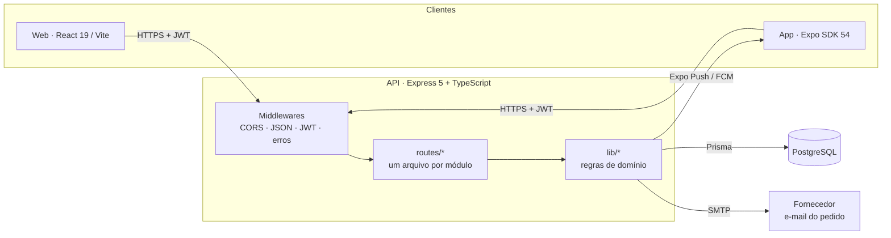

<div align="center">

# ViaPro ERP · API

**Backend de um ERP de armazém com WMS, PCP, compras, financeiro e BI logístico.**

Regras de estoque no servidor, ledger auditável com hash encadeado, previsão de demanda e alertas push em tempo real.


[Visão geral](#visão-geral) · [Arquitetura](#arquitetura) · [Módulos](#módulos-de-domínio) · [Decisões técnicas](#decisões-técnicas) · [Como rodar](#como-rodar) · [Endpoints](#mapa-de-endpoints)

</div>

---

## Visão geral

O ViaPro ERP atende a operação de um distribuidor e montador de produtos: recebe mercadoria, endereça no armazém, separa pedidos, produz kits, controla lotes e validade, compra por necessidade e acompanha o caixa. Esta API é a fonte única de verdade para os dois clientes:

| Cliente | Repositório | Uso |
|---|---|---|
| Web (React) | [`munila-frontend`](https://github.com/rodrigoarcanjo23/munila-frontend) | Gestão completa, BI, PCP e financeiro |
| App (Expo / React Native) | `controle-estoque-mobile` | Coletor do armazém: separação, movimentações, apontamento de produção e alerta de nova ordem |

**Em números:** 17 módulos de rota · ~155 endpoints · 35 modelos no banco · 0 regra de estoque no cliente.

## Arquitetura



```
src/
├── server.ts            # bootstrap: migrações de dados idempotentes e listen
├── app.ts               # composição: middlewares, rotas, 404 e error handler
├── seed.ts
├── lib/                 # domínio, sem dependência de HTTP
│   ├── estoque.ts       # tipos de movimento, saldo por lote/armazém, FEFO, códigos RE/RS/OS/PC
│   ├── tf.ts            # ledger com hash encadeado, lock transacional, verificação de integridade
│   ├── previsao.ts      # suavização exponencial de Holt (nível + tendência) com intervalo
│   ├── painel.ts        # central de operação e pendências de cadastro
│   ├── financeiro.ts    # títulos, parcelas e baixa
│   ├── notificacoes.ts  # push via Expo (canal Android dedicado e limpeza de tokens inválidos)
│   ├── auth.ts          # bcrypt, JWT e migração de senha legada no login
│   └── http.ts          # helpers de validação e erros HTTP tipados
└── routes/              # 16 módulos (auth, produtos, estoque, wms, compras, pcp, tf, bi, ...)
```

As rotas só traduzem HTTP para chamadas de domínio. Cálculo de saldo, FEFO, rendimento, previsão e alertas ficam em `lib/`, onde podem ser reutilizados entre módulos (o mesmo `consumoPorProduto` alimenta Curva ABC, sugestão de compras, MRP e BI).

## Módulos de domínio

| Módulo | O que resolve | Destaques técnicos |
|---|---|---|
| **Estoque e Kardex** | Saldo por produto, lote, armazém e endereço | Saldo derivado de movimentos tipados; Kardex com saldo após cada lançamento; documento RE/RS em cada movimento |
| **WMS / Separação** | Ordens de separação com prioridade e checklist | Picking FEFO, progresso salvo por item, push para o app quando uma ordem nasce |
| **Mapa, slotting e ondas** | Endereçamento por rua/módulo/nível, reposicionamento por giro e separação em lote | Rota em serpentina (S-shape), ABC por coletas com zona dourada, troca sugerida por ganho líquido em metros, afinidade entre produtos (Jaccard), ondas com caixa por pedido |
| **Inventário** | Contagem geral ou cíclica | Contagem cega, contagem por lote, ajustes automáticos com rastreabilidade |
| **Compras** | Pedido, recebimento e sugestão de compra | Ponto de pedido com lead time e estoque de segurança, conferência cega, divergência NF × recebido, e-mail ao fornecedor |
| **Entrada por NF-e** | Importar XML da nota | Vínculo por EAN/SKU, fator de conversão (CX→UN), atualização de custo |
| **Armazéns** | Multi-armazém | Transferência entre armazéns sem distorcer entradas e saídas da empresa |
| **Financeiro** | Contas a pagar e a receber, fluxo de caixa | Parcelamento, baixa e estorno, títulos gerados na entrada por NF-e, saldo por conta bancária |
| **PCP** | Ordens de produção, plano mestre, MRP, recursos e fichas técnicas | Estrutura multinível com detecção de ciclo, MRP com data de necessidade × lead time, apontamento com refugo |
| **Transformação** | Estoque segregado de conversão matéria-prima → produto | Ledger imutável com hash encadeado, receitas versionadas, tolerância com aprovação de segundo usuário, genealogia de lote |
| **BI logístico** | Indicadores e recomendações | Previsão de Holt, matriz ABC × XYZ, OTIF de fornecedores, cobertura, risco de ruptura, rebalanceamento entre armazéns |
| **Painel** | Central da operação | Filas, agenda de recebimentos, produção em andamento, equipe do dia e qualidade do cadastro |

## Decisões técnicas

<details open>
<summary><b>Auditabilidade com hash encadeado (módulo de Transformação)</b></summary>

Cada movimento e cada evento recebe `hash = SHA-256(hashAnterior + JSON canônico do registro)`. O JSON é serializado com chaves ordenadas porque o PostgreSQL reordena chaves em colunas `jsonb`, o que quebraria a verificação. As escritas são serializadas com `pg_advisory_xact_lock`, então a corrente nunca bifurca sob concorrência.

`GET /tf/integridade` recalcula as duas correntes e confere o saldo de cada lote contra a soma do ledger. Uma edição feita direto no banco aparece apontando o número do registro adulterado. Correção só existe como novo lançamento (ajuste com motivo ou estorno). Nada é editado nem apagado.
</details>

<details>
<summary><b>Segregação de responsabilidades por aprovação</b></summary>

O rendimento de uma ordem de transformação é `produzido ÷ esperado`, em que o esperado vem do insumo mais restritivo consumido de fato. A variação de cada insumo é comparada às faixas da receita:

- dentro da tolerância: conclui;
- fora da 1ª faixa: exige justificativa;
- fora da 2ª faixa: a ordem fica **aguardando aprovação** e o estoque só movimenta quando um gestor que não seja quem executou aprova.

O balanço de massa só é calculado quando todas as unidades são de massa ou volume, para não somar peças com quilos.
</details>

<details>
<summary><b>Previsão de demanda sem dependência externa</b></summary>

`lib/previsao.ts` implementa a suavização exponencial dupla de Holt sobre a série semanal de consumo, com faixa de 80% derivada do erro de ajuste. A mesma função alimenta o BI (demanda das próximas semanas) e o plano mestre do PCP.
</details>

<details>
<summary><b>Evolução de schema sem downtime</b></summary>

O deploy no Render usa `prisma db push`. Por isso **toda mudança de schema é aditiva**: campos novos são opcionais ou têm default, e nada é renomeado nem removido. Migrações de dados (por exemplo, trazer o módulo legado de transformação para o ledger novo) rodam na subida do servidor e são idempotentes por chave de origem (`legadoId`). O comando `--accept-data-loss` nunca é usado.
</details>

<details>
<summary><b>Autenticação com migração suave</b></summary>

As senhas legadas em texto puro são convertidas para bcrypt no primeiro login de cada usuário, sem reset em massa. O JWT é lido sempre que enviado. A exigência é ligada por `AUTH_OBRIGATORIA=true` depois que web e app atualizados estão publicados, para não derrubar instalações antigas do app.
</details>

<details>
<summary><b>Notificações push confiáveis</b></summary>

Nova ordem de separação dispara push pelo Expo Push Service (FCM V1) em um canal Android próprio, com som customizado. Tokens que respondem `DeviceNotRegistered` são removidos, e o app tem fallback por polling (`GET /wms/ordens/novas`), então nenhuma ordem passa despercebida se o push falhar.
</details>

## Como rodar

**Requisitos:** Node.js 20+ e PostgreSQL 14+.

```bash
git clone https://github.com/rodrigoarcanjo23/munila-backend.git
cd munila-backend
npm install
cp .env.example .env          # preencha DATABASE_URL e JWT_SECRET
npx prisma db push            # cria as tabelas
npm run seed                  # opcional: dados de exemplo
npm run dev                   # http://localhost:3333
```

### Variáveis de ambiente

| Variável | Obrigatória | Descrição |
|---|:---:|---|
| `DATABASE_URL` | ✅ | Conexão PostgreSQL |
| `JWT_SECRET` | ✅ em produção | Segredo para assinar o token de login |
| `AUTH_OBRIGATORIA` | | `true` passa a exigir token em todas as rotas (padrão `false`) |
| `EMAIL_USER` / `EMAIL_PASS` | | Envia o pedido de compra ao fornecedor por e-mail (Gmail com senha de app) |
| `PORT` | | Porta HTTP (padrão `3333`) |

### Scripts

| Script | Faz |
|---|---|
| `npm run dev` | Servidor com reload (ts-node-dev) |
| `npm run build` | `prisma generate` + compilação TypeScript para `dist/` |
| `npm start` | Executa a build |
| `npm run db:push` | Sincroniza o schema com o banco |
| `npm run seed` | Popula dados de exemplo |

### Deploy (Render)

Configuração sugerida:

- **Build:** `npm install && npx prisma db push && npm run build`
- **Start:** `npm start`
- Configure as variáveis acima no painel do serviço.
- Publique a API antes do front, porque o front pode depender de campos novos.

## Mapa de endpoints

Todas as rotas respondem JSON. Erros seguem `{ "error": "mensagem legível" }` com o status HTTP adequado.

| Prefixo | Principais rotas |
|---|---|
| `/login` · `/me` · `/usuarios` | Login (JWT), perfil, gestão de usuários, registro de push token |
| `/produtos` | CRUD, `busca` por EAN/SKU, `pendencias` de cadastro, `:id/kardex` |
| `/categorias` · `/localizacoes` | Cadastros de apoio e endereços |
| `/estoque` · `/movimentacoes` | Saldo por lote/armazém, operações (entrada, saída, devolução, demonstração, perda), auditoria |
| `/armazens` | Armazéns e transferências |
| `/wms/ordens` | Ordens de separação, iniciar, marcar item, concluir, `novas` (polling do app) |
| `/wms/layout` · `/wms/slotting` · `/wms/ondas` | Mapa do armazém, gerador de endereços, sugestões de remanejamento, ondas com rota |
| `/inventarios` | Abertura, contagem (cega e por lote), conclusão com ajustes |
| `/pedidos-compra` · `/compras/sugestao` · `/recebimentos/nfe` | Compras, sugestão por necessidade, entrada por XML |
| `/financeiro/*` | Títulos, baixas, contas bancárias, fluxo de caixa |
| `/pcp/*` | Recursos, ordens de produção, apontamentos, plano mestre, MRP, estruturas e custo |
| `/tf/*` | Transformação: materiais, lotes, receitas, ordens, rastreio, auditoria, integridade |
| `/dashboard/painel` | Central da operação |
| `/bi/painel` | BI logístico (`dias`, `armazemId`, `categoriaId`) |
| `/gerencial/*` | Curva ABC, validade |
| `/empresa` · `/fiscal/pendencias` | Dados da empresa e preparação para NF-e |

## Roadmap

- [ ] Emissão de NF-e por provedor homologado (cadastro fiscal já preparado)
- [ ] Sugestão de endereço no recebimento (putaway dirigido) usando o mapa
- [ ] Pedido de venda com reserva de estoque
- [ ] Testes automatizados das regras de `lib/` e pipeline de CI
- [ ] Multiempresa (vários CNPJs)

---

<div align="center">
Desenvolvido por <a href="https://github.com/rodrigoarcanjo23">Rodrigo Arcanjo</a>
</div>
